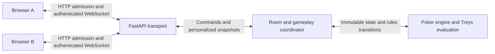

# Six-slide presentation handoff

Content and speaker notes follow the official template. Fill the final
verified submission SHA and confirmed EIDs in the deck separately.
Partner review and PDF export remain open.
[Official guide](https://www.cs.utexas.edu/~witchel/378AC/lectures/948_final_project_guide-slides.pdf)

## 1. A private poker table in two browsers

**On slide.** Heads-Up Live Poker. Deepthi Morusupalli and Srishruthik
Alle. Two friends can use virtual chips to play a fixed-limit hand in
separate browsers. The demo begins with independent seat admission and
ends at a known-answer showdown. Show the public repository URL and
insert the exact verified submission SHA. Use confirmed EIDs in the
separately reviewed deck. [Repository](https://github.com/shruthikalle/poker-)

**Visual and speaker.** Both introduce the goal and hand off to the
two-browser setup. Use the [actual two-player table capture](../browser-interface/screenshots/active.png).
Explain that the demo uses loopback and a known deck. Move to the live
application for the table actions. Browser and package verification
support the workflow.

## 2. What we contributed

**On slide.** The proposal started without an existing codebase.
The README-only root is `c29bade`, and `34aa241` is the first engine
and the stated starting checkpoint. Srishruthik owns immutable engine
transitions, betting, payout and original lobby work. Deepthi owns
canonical admission, authenticated coordination, timers, snapshots,
browser and verification. Both own final integration and policy.
Codex helped implement changes, diagnose issues and test outcomes under
contributor direction. Treys 0.1.8 evaluates and represents cards.
FastAPI 0.165.0 supplies the transport framework.

**Speaker notes.** Srishruthik explains `new_game`, `legal_actions`, and
`apply_action`. Deepthi explains current-seat authority and filtered
views. The initial engine had no live server entry point. The comparable
browser checkpoint `b051973` exposes the same network-loss case and the
improved runtime passes it. Keep those two baselines distinct. Review
both contributor descriptions together.
[Engine](../../poker/engine.py) · [Coordinator](../../server/coordinator.py) ·
[Attribution](contribution-inventory.md) · [Measured comparison](historical-comparison-results.txt)

## 3. Recover a seat after a lost response

**Choice and change.** Deepthi considered blind HTTP retry or restarting
the table. She directed Codex to use a random recovery key and to hold
lookup and allocation under the room lock. The browser saves the
operation before sending it. Successful replay preserves the original
response and uses bounded records. `e4eec2b` contains the change.

**Evidence and response.** Use the same browser fault probe against the
archived pre-recovery app and the improved app. After an upstream
success, drop the browser response. Create changed from 201/409 to
201/201 and join from 200/409 to 200/200. The improved run recovered the
original seat after refresh and started at one set of blinds.
Keep the keyed route. Restart still clears its process-local records.
[Room manager](../../poker/rooms.py) · [Probe](../browser-reliability/recovery_probe.py) ·
[Results](historical-comparison-results.txt) · [Reproduction](evidence-manifest.md)

## 4. Reconcile deadlines where commands commit

**Choice and change.** Deepthi compared a timer-callback-only model with
checking expiry under the room lock before handling an action or
connection change. Codex implemented the coordinator and deterministic
clock checks in `9247cd0` and `29f95bb).

**Evidence and response.** A turn expired at 30 seconds. At 35 seconds,
with the callback yet to run, the controlled model accepted a late call
and left pot 20. The real coordinator folded A before handling it and
settled at revision 2, pot 0, A 195/B 205. Another case preserved 30
seconds of active play across a pause where full reset modeled 42.
Retain deadline reconciliation at ingress. This is a deterministic
ordering check, with real-time scheduling latency outside its claim.
[Coordinator](../../server/coordinator.py) · [Generator](../deepthi-day-3/decision-deadlines.py) ·
[Deadline assertions](../../tests/test_deadlines.py) · [Results](historical-comparison-results.txt)

## 5. An acknowledgment went missing and the tab kept waiting

**Symptom and diagnosis.** Deepthi's browser accepted an action from
A, and the other player saw the 20-chip pot. The acting browser stayed
pending. The probe dropped a real acknowledgment and let snapshots
continue. The other player's pot and revision showed that the engine
had committed. Successive snapshots were resetting the browser's
watchdog before it could fire.

**Fix and regression.** `3391a65` uses one monotonic deadline per
transmission. The old browser was still pending at 5.80 seconds. The
fixed browser resent the same bytes at about 4.51 seconds. One
authoritative transition remained at revision 2 and pot 20. Deepthi
explains the diagnosis while the audience sees the exact comparison.
These elapsed times are observations from the fixture.
[Watchdog source](../../server/static/js/network.mjs) ·
[Client regression](../../tests/browser/client.test.mjs) · [Results](historical-comparison-results.txt)

## 6. Restarting the server interrupts an active match

**On slide.** Active game, sessions and replay records are in memory.
After a process restart, the browser detects an invalid session. The
current fixture demonstrates this. It cannot restore the old hand,
turn clock or replay history from the prior process.

**Speaker notes.** Both explain that future persistence would need to
commit room state, seat identity, and replay metadata atomically.
The first follow-up check would stop the process after an accepted call
whose acknowledgment was lost, then verify the same token and exact
command once across restart. Keep durable recovery as future work.
Joint rule and pot approvals remain pending.
[Restart result](browser-verification-results.txt) · [Policy proposed for review](joint-approval-status.md)

## Decision backups and claim limits

1. **Personalized allowlists** by Deepthi. Controlled raw engine state
   exposed two opponent cards, 48 unrevealed cards and four internal
   fields. Seat A's production snapshot exposed zero of each.
   This tests selected fields at a known state. `6aca6fb`.
   [Generator](../deepthi-day-2/decision-privacy.py) · [Results](historical-comparison-results.txt)
2. **Atomic command coordination** by Deepthi. In the controlled split
   check, two handlers computed accepted transitions from the same
   revision. Pot 20 and conservation alone missed the false second
   accept. Production committed one transition and one revision.
   This is a modeled comparison with a deterministic race.
   `cc59158`. [Generator](../deepthi-day-2/decision-coordination.py) · [Results](historical-comparison-results.txt)

The available partner evidence supports an independently calculated
engine demonstration and contribution credit. No comparable engine-side
alternative experiment was found. Use the four decision options above
for claims with recorded alternatives, and include the engine's known
answer in the live sequence.
